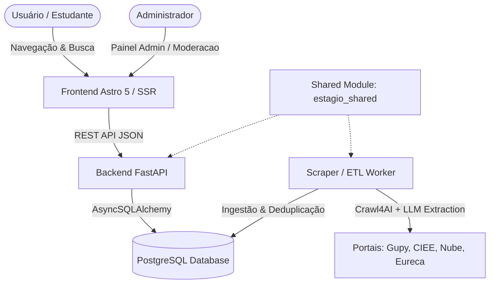

# 🎓 estagio.io — Agregador Inteligente de Vagas de Estágio

<p align="center">
  
  
  
  
  
  
</p>

---

## 📌 Sobre o Projeto

O **estagio.io** é uma plataforma completa e moderna de agregação e inteligência de vagas de estágio no Brasil. Nosso objetivo é **centralizar, sanitizar e organizar** oportunidades espalhadas nos maiores portais corporativos (Gupy, CIEE, Nube, Eureca, entre outros) em um único ambiente rápido, gratuito e orientado a SEO.

A solução é construída com arquitetura desacoplada em micro-serviços/módulos, utilizando extratores inteligentes por Inteligência Artificial (LLM + Crawl4AI) para classificação automatizada de áreas, regimes de trabalho e deduplicação de oportunidades.

---

## ✨ Principais Funcionalidades

- 🔍 **Busca & Filtros Inteligentes**: Pesquisa por cargo, empresa, palavras-chave, localização e filtros rápidos por modalidade (Remoto, Híbrido, Presencial) e tipo de jornada.
- 🎯 **Classificação Determinística & LLM por Áreas**: Suporte automatizado às áreas de TI/Software, Dados, Design, Marketing, RH, Finanças, Engenharia, Direito, Negócios e **Programas de Estágio (Multi-Áreas)**.
- 🚀 **SEO & Métadados Ricos (Schema.org)**: Páginas dinâmicas indexáveis por buscadores utilizando a estrutura formal `JobPosting`.
- 🔐 **Painel Administrativo Protegido (`/admin/login`)**:
  - Autenticação HMAC via cookies HTTP-Only com proteção contra força bruta (Rate Limit).
  - Moderação de vagas em destaque (*featured*), ativação e exclusão.
  - Execução e disparo manual dos pipelines de scraping/ETL.
- 🎨 **Design Moderno & Responsivo**: Suporte completo a **Light e Dark Mode** com alto contraste e micro-animações.
- 🔄 **Deduplicação de Oportunidades**: Algoritmos de ordenação e limpeza para remover vagas duplicadas ou ultrapassadas.

---

## 🛠️ Arquitetura e Tecnologias



| Camada | Tecnologias Principais |
| :--- | :--- |
| **Frontend** | Astro 5 (Node SSR), Tailwind CSS v4, TypeScript, Vitest |
| **Backend API** | FastAPI (Python 3.12), AsyncSQLAlchemy, Alembic, Pydantic v2 |
| **Scraper / ETL** | Crawl4AI, Groq / OpenAI LLM, BeautifulSoup, RegEx Multi-Stage |
| **Módulo Core** | `shared/estagio_shared` (Modelos SQLAlchemy, Taxonomia, Extrator) |
| **Banco de Dados** | PostgreSQL 16 (com SQLite assíncrono para suíte de testes) |
| **Infraestrutura** | Docker, Docker Compose, Nginx (opcional) |

---

## 📂 Estrutura do Repositório

```text
estagio.io/
├── backend/                  # API REST em FastAPI
│   ├── app/                  # Endpoints v1 (jobs, admin), segurança e schemas
│   ├── alembic/              # Migrações do banco de dados
│   └── tests/                # Suíte de testes com pytest
├── frontend/                 # Aplicação web em Astro 5
│   ├── src/
│   │   ├── components/       # Componentes UI (JobCard, AdminDashboard, Header, Footer)
│   │   ├── pages/            # Rotas públicas (/vagas, /sobre) e restritas (/admin/*)
│   │   ├── lib/              # Cliente API e módulo de autenticação HMAC
│   │   └── styles/           # CSS Global e Design System em Tailwind v4
│   └── vitest.config.ts      # Configuração de testes frontend
├── scraper/                  # Workers de web scraping e pipelines ETL
│   ├── src/                  # Scripts de execução Crawl4AI e Groq/LLM
│   └── tests/                # Testes automatizados dos extratores
├── shared/                   # Pacote compartilhado estagio_shared
│   └── estagio_shared/       # Database, Models, Taxonomia, Dedup e Extrator
├── docs/                     # Planos de projeto e roadmaps técnicos
├── docker-compose.yml        # Orquestração dos containers
└── .env.example              # Modelo de variáveis de ambiente
```

---

## 🚀 Como Executar o Projeto

### Pré-requisitos

- **Docker** e **Docker Compose** instalados (Recomendado)
- **Node.js** (v20+) e **Python** (v3.12+) caso deseje executar sem Docker.

---

### Opção 1: Usando Docker Compose (Recomendado)

1. **Clone o repositório**:
   ```bash
   git clone https://github.com/Fredson-Santos/estagio.io.git
   cd estagio.io
   ```

2. **Configure as Variáveis de Ambiente**:
   ```bash
   cp .env.example .env
   ```

3. **Suba os containers**:
   ```bash
   docker compose up --build -d
   ```

4. **Acesse as aplicações**:
   - **Frontend (Web)**: `http://localhost:4321`
   - **Painel Administrativo**: `http://localhost:4321/admin/login`
   - **Backend API Docs (Swagger)**: `http://localhost:8000/docs`

---

### Opção 2: Execução Manual (Serviço por Serviço)

#### 1. Módulo Compartilhado (`shared`)
```bash
cd shared
pip install -e .
```

#### 2. Backend (`FastAPI`)
```bash
cd backend
python -m venv .venv
# Ativar venv (.venv\Scripts\activate no Windows ou source .venv/bin/activate no Linux/macOS)
pip install -r requirements.txt
python -m uvicorn app.main:app --reload --port 8000
```

#### 3. Frontend (`Astro`)
```bash
cd frontend
npm install
npm run dev
```

#### 4. Scraper / ETL (`Python`)
```bash
cd scraper
pip install -r requirements.txt
python main.py
```

---

## 🧪 Execução de Testes Automatizados

O projeto possui cobertura de testes automatizados para todas as suas camadas:

### 1. Testes do Frontend (Vitest)
```bash
cd frontend
npm test
```

### 2. Testes do Backend (Pytest)
```bash
cd backend
$env:DATABASE_URL="sqlite+aiosqlite:///:memory:"
python -m pytest tests
```

### 3. Testes dos Scrapers (Pytest)
```bash
$env:PYTHONPATH="shared;scraper"
python -m pytest scraper/tests
```

---

## 🔐 Painel Administrativo

Acesse `/admin/login` na aplicação frontend para gerenciar a plataforma:

- **Senha Padrão de Desenvolvimento**: `changeme_admin_password` (Definida via `ADMIN_PASSWORD` no `.env`).
- **Recursos**:
  - Marcar/Desmarcar vagas como **Destaque** (*Featured*).
  - Ativar/Desativar visibilidade de vagas.
  - Executar manualmente o pipeline do Scraper/ETL com 1 clique.
  - Métricas gerais de vagas ativas, fontes integradas e última execução.

---

## 📄 Licença

Este projeto é desenvolvido sob a licença **MIT**. Veja o arquivo `LICENSE` para mais detalhes.

<p align="center">
  Desenvolvido por <a href="https://github.com/Fredson-Santos">Fredson Santos</a> 🚀
</p>
