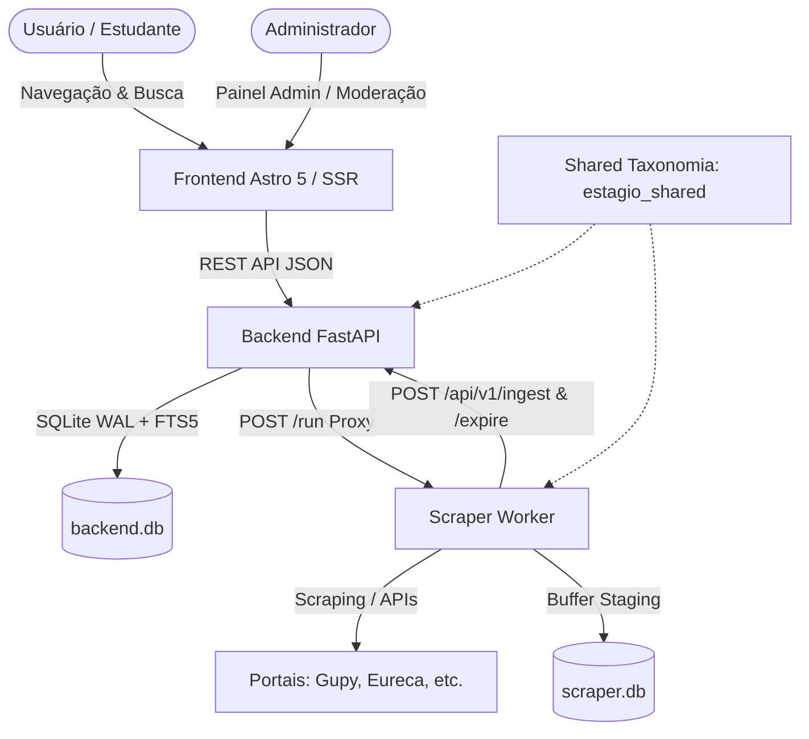

# 🎓 estagio.io — Agregador Inteligente de Vagas de Estágio

<p align="center">
  
  
  
  
  
  
</p>

---

## 📌 Sobre o Projeto 

O **estagio.io** é uma plataforma completa e moderna de agregação e inteligência de vagas de estágio no Brasil. Nosso objetivo é **centralizar, sanitizar e organizar** oportunidades espalhadas nos maiores portais corporativos (Gupy, CIEE, Nube, Eureca, entre outros) em um único ambiente rápido, gratuito e orientado a SEO.

A solução é construída com arquitetura desacoplada em 3 serviços independentes (Frontend, Backend API e Scraper Worker) utilizando SQLite com WAL mode em cada lado e sincronização HTTP idempotente via API.

---

## ✨ Principais Funcionalidades

- 🔍 **Busca & Filtros Inteligentes (FTS5)**: Pesquisa textual rápida via SQLite FTS5 por cargo, empresa, palavras-chave, localização e filtros rápidos por modalidade (Remoto, Híbrido, Presencial) e tipo de jornada.
- 🎯 **Classificação Determinística & LLM por Áreas**: Suporte automatizado às áreas de TI/Software, Dados, Design, Marketing, RH, Finanças, Engenharia, Direito, Negócios e **Programas de Estágio (Multi-Áreas)**.
- 🚀 **SEO & Métadados Ricos (Schema.org)**: Páginas dinâmicas indexáveis por buscadores utilizando a estrutura formal `JobPosting`.
- 🔐 **Painel Administrativo Protegido (`/admin/login`)**:
  - Autenticação HMAC via cookies HTTP-Only com proteção contra força bruta (Rate Limit).
  - Moderação de vagas em destaque (*featured*), ativação e exclusão.
  - Execução e disparo manual dos pipelines de scraping/ETL.
- 🎨 **Design Moderno & Responsivo**: Suporte completo a **Light e Dark Mode** com alto contraste e micro-animações.
- 🔄 **Deduplicação & Expiração de Oportunidades**: Ingestão idempotente por `source_url`, desduplicação fuzzy via RapidFuzz e sincronização automática de vagas expiradas.

---

## 🛠️ Arquitetura e Tecnologias



| Camada | Tecnologias Principais |
| :--- | :--- |
| **Frontend** | Astro 5 (Node SSR), Tailwind CSS v4, TypeScript, Vitest |
| **Backend API** | FastAPI (Python 3.12), SQLite (aiosqlite + WAL + FTS5), Alembic, Pydantic v2 |
| **Scraper Worker** | Python 3.12, BeautifulSoup, HTTPX, Groq / OpenAI LLM, APScheduler |
| **Taxonomia Core** | `shared/estagio_shared/taxonomy.py` (Enums de Áreas, Modalidades e Status) |
| **Banco de Dados** | SQLite3 independente no Backend (`backend.db`) e Scraper (`scraper.db`) |
| **Infraestrutura** | Docker, Docker Compose (3 containers) |

---

## 📂 Estrutura do Repositório

```text
estagio.io/
├── backend/                  # API REST em FastAPI (com backend.db local)
│   ├── app/                  # Endpoints v1 (jobs, admin, ingest), segurança e schemas
│   ├── alembic/              # Migrações SQLite (FTS5 + Triggers)
│   └── tests/                # Suíte de testes com pytest
├── frontend/                 # Aplicação web em Astro 5
│   ├── src/
│   │   ├── components/       # Componentes UI (JobCard, AdminDashboard, Header, Footer)
│   │   ├── pages/            # Rotas públicas (/vagas, /sobre) e restritas (/admin/*)
│   │   ├── lib/              # Cliente API e módulo de autenticação HMAC
│   │   └── styles/           # CSS Global e Design System em Tailwind v4
│   └── vitest.config.ts      # Configuração de testes frontend
├── scraper/                  # Workers de web scraping e pipelines ETL (com scraper.db local)
│   ├── src/                  # Scrapers (Gupy, Eureca, etc.), sync, health_check e main.py
│   └── tests/                # Testes automatizados dos extratores e sync
├── shared/                   # Pacote compartilhado estagio_shared (taxonomy.py)
├── docs/                     # Planos de projeto e arquitetura v4
├── docker-compose.yml        # Orquestração dos 3 containers (Frontend, Backend, Scraper)
└── .env.example              # Modelo de variáveis de ambiente
```

---

## 🚀 Como Executar o Projeto

### Opção 1: Usando Docker Compose (Recomendado)

1. **Clone o repositório**:
   ```bash
   git clone https://github.com/Fredson-Santos/estagio.io.git
   cd estagio.io
   ```

2. **Configure as Variáveis de Ambiente**:
   ```bash
   cp .env.example .env
   ```

3. **Suba os containers**:
   ```bash
   docker compose up --build -d
   ```

4. **Acesse as aplicações**:
   - **Frontend (Web)**: `http://localhost:4321`
   - **Painel Administrativo**: `http://localhost:4321/admin/login`
   - **Backend API Docs (Swagger)**: `http://localhost:8001/docs`

---

## 🧪 Execução de Testes Automatizados

O projeto possui cobertura total de testes automatizados para todas as suas camadas:

### 1. Testes do Frontend (Vitest)
```bash
cd frontend
npm test
```

### 2. Testes do Backend (Pytest)
```bash
cd backend
python -m pytest tests/ -v
```

### 3. Testes do Scraper (Pytest)
```bash
cd scraper
python -m pytest tests/ -v
```

---

## 📄 Licença

Este projeto é desenvolvido sob a licença **MIT**. Veja o arquivo `LICENSE` para mais detalhes.

<p align="center">
  Desenvolvido por <a href="https://github.com/Fredson-Santos">Fredson Santos</a> (<a href="mailto:fredsonf219@gmail.com">fredsonf219@gmail.com</a>) 🚀
</p>
