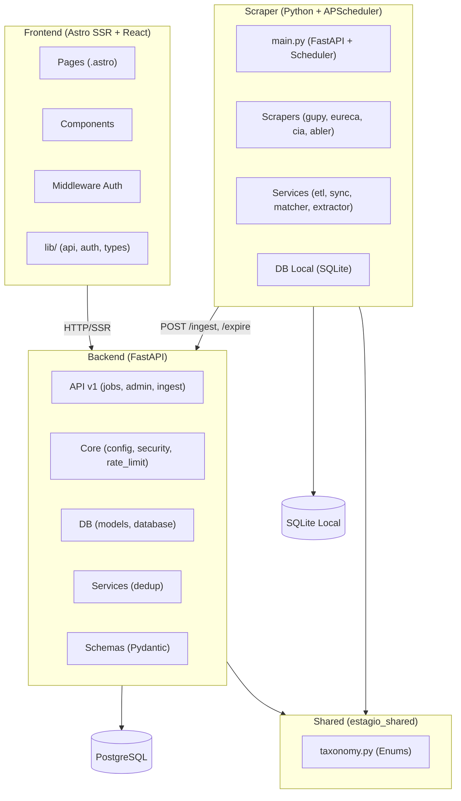

# 🔍 Análise Completa da Codebase — estagio.io

> **Stack**: FastAPI + PostgreSQL + Astro (SSR) + React + Scraper (Python)
> **Data**: 2026-08-08
> **Arquivos analisados**: ~80 arquivos em backend, frontend, scraper e shared

---

## Sumário Executivo

| Categoria | Críticos | Médios | Baixos |
|---|---|---|---|
| Segurança | **2** | 3 | 2 |
| Performance | 0 | **3** | 2 |
| Qualidade de Código | 0 | **4** | 3 |
| Testes | 0 | **3** | 2 |
| Dívida Técnica | 0 | 2 | **3** |

---

## 1. Arquitetura Geral e Organização

### Visão Geral



### Pontos Fortes ✅
- **Separação clara de serviços**: Backend, Frontend e Scraper são serviços independentes com Docker
- **Shared package** (`estagio_shared`): Taxonomia de enums compartilhada evita divergência
- **API versionada** (`/api/v1`): Preparada para evolução
- **Rate limiting** implementado com `slowapi`
- **Full-text search** com TSVECTOR no PostgreSQL e fallback ILIKE para SQLite
- **Deduplicação** em dois níveis: URL exata (backend) + fuzzy (scraper com `rapidfuzz`)
- **Auth admin** com HMAC + timing-safe comparison no frontend

### Pontos de Atenção ⚠️

| Severidade | Achado | Detalhes |
|---|---|---|
| Médio | Sem limite de payload no `/ingest` | [ingest.py:60](file:///c:/Users/Fred/Projetos/estagio.io/backend/app/api/v1/endpoints/ingest.py#L60) — `IngestRequest` aceita `list[IngestJobItem]` sem limite de tamanho. Um scraper bugado pode enviar 100K items em um único POST |
| Baixo | `LLM_PROVIDER=groq` duplicado | [.env:6-7](file:///c:/Users/Fred/Projetos/estagio.io/.env#L6-L7) — Linha duplicada |
| Baixo | `checkOrigin: false` no Astro | [astro.config.mjs:15](file:///c:/Users/Fred/Projetos/estagio.io/frontend/astro.config.mjs#L15) — Desabilita verificação de origem, pode facilitar CSRF em endpoints POST do admin |

---

## 2. Segurança

### 🚨 CRÍTICO: Chave API Groq Real Exposta no `.env` Local

> [!CAUTION]
> O arquivo [.env](file:///c:/Users/Fred/Projetos/estagio.io/.env#L9) contém uma **chave API Groq real**:
> ```
> GROQ_API_KEY=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
> ```
> Embora o `.env` esteja no `.gitignore` e **não esteja tracked no Git** (verificado via `git ls-files`), a chave está em texto claro no filesystem. Se já foi commitada em algum branch antigo, ela pode ser recuperável.

**Severidade**: 🔴 Crítico
**Correção**: Revogar esta chave na dashboard da Groq e gerar uma nova. Usar `.env.example` apenas com placeholders.

---

### 🚨 CRÍTICO: `ADMIN_API_KEY` Compartilhada Sem Rotação

> [!CAUTION]
> A mesma `ADMIN_API_KEY` é usada em **todos os serviços** (Backend, Frontend, Scraper) como autenticação inter-serviço. Se comprometida, um atacante pode:
> - Injetar vagas falsas via `/ingest`
> - Expirar todas as vagas via `/expire`
> - Acessar stats admin via `/admin/stats`
> - Deletar/editar qualquer vaga

**Arquivos afetados**:
- [docker-compose.yml:32,55,78](file:///c:/Users/Fred/Projetos/estagio.io/docker-compose.yml#L32)
- [security.py:7](file:///c:/Users/Fred/Projetos/estagio.io/backend/app/core/security.py#L7) — Comparação simples de string (sem timing-safe)

**Severidade**: 🔴 Crítico
**Correção**:
1. Usar `hmac.compare_digest()` na comparação da API key no backend
2. Implementar chaves separadas para cada serviço
3. Adicionar rotação periódica

```diff
# backend/app/core/security.py
+import hmac
+
 async def verify_admin_key(x_admin_key: str | None = Header(default=None, alias="X-Admin-Key")):
-    if not settings.ADMIN_API_KEY or x_admin_key != settings.ADMIN_API_KEY:
+    if not settings.ADMIN_API_KEY or not x_admin_key:
+        raise HTTPException(status_code=status.HTTP_401_UNAUTHORIZED, detail="Não autorizado")
+    if not hmac.compare_digest(x_admin_key, settings.ADMIN_API_KEY):
         raise HTTPException(status_code=status.HTTP_401_UNAUTHORIZED, detail="Não autorizado")
```

---

### 🟡 MÉDIO: CORS Permite `allow_headers=["*"]`

**Arquivo**: [main.py:23](file:///c:/Users/Fred/Projetos/estagio.io/backend/app/main.py#L23)
```python
allow_headers=["*"],
```

**Risco**: Permite qualquer header customizado em requests cross-origin, ampliando superfície de ataque.
**Correção**: Restringir a `["Content-Type", "Accept", "X-Admin-Key", "Authorization"]`.

---

### 🟡 MÉDIO: `checkOrigin: false` no Astro SSR

**Arquivo**: [astro.config.mjs:15](file:///c:/Users/Fred/Projetos/estagio.io/frontend/astro.config.mjs#L15)
```js
security: { checkOrigin: false },
```

**Risco**: Endpoints SSR que processam POST (como [login.astro](file:///c:/Users/Fred/Projetos/estagio.io/frontend/src/pages/admin/login.astro)) ficam vulneráveis a CSRF.
**Correção**: Remover ou trocar para `true` e testar login e admin API.

---

### 🟡 MÉDIO: Scraper autenticação fraca no endpoint `/run`

**Arquivo**: [scraper/main.py:86-88](file:///c:/Users/Fred/Projetos/estagio.io/scraper/src/main.py#L86-L88)
```python
expected_key = settings.BACKEND_API_KEY
if expected_key and x_admin_key != expected_key:
```

**Risco**: Se `BACKEND_API_KEY` estiver vazia (string vazia, que é o default), **qualquer pessoa pode disparar o scraper**.
**Correção**: Falhar se a key não estiver configurada (em vez de bypass).

---

### 🟢 BAIXO: Rate limit map in-memory sem cleanup

**Arquivo**: [auth.ts:107](file:///c:/Users/Fred/Projetos/estagio.io/frontend/src/lib/auth.ts#L107)
```ts
const rateLimitMap = new Map<string, number[]>();
```

**Risco**: Memory leak lento — entries nunca são removidas do Map. Em produção com muitos IPs, pode crescer indefinidamente.
**Correção**: Adicionar cleanup periódico ou usar TTL-based cache.

---

### 🟢 BAIXO: `IngestJobItem` aceita qualquer URL em `source_url` e `company_logo`

**Arquivo**: [ingest.py:19](file:///c:/Users/Fred/Projetos/estagio.io/backend/app/schemas/ingest.py#L19)

**Risco**: Não valida se `source_url` é HTTP/HTTPS válido ou se `company_logo` aponta para domínio malicioso (potencial XSS via imagem).
**Correção**: Adicionar `HttpUrl` do Pydantic ou validação regex.

---

## 3. Performance

### 🟡 MÉDIO: Deduplicação O(n²) no Scraper

**Arquivo**: [scraper/services/dedup.py:13](file:///c:/Users/Fred/Projetos/estagio.io/scraper/src/services/dedup.py#L13)
```python
for job in existing_jobs:
    existing_str = f"{job.get('title', '')} ...".lower()
    similarity = fuzz.token_sort_ratio(new_str, existing_str)
```

**Problema**: Para cada nova vaga, itera **todas** as vagas existentes com `fuzz.token_sort_ratio`. Na [etl.py:112-116](file:///c:/Users/Fred/Projetos/estagio.io/scraper/src/services/etl.py#L112-L116), `existing_jobs` carrega **todos os ScrapedJob** do banco em memória:
```python
result = await session.execute(select(ScrapedJob))
existing_jobs = [
    {"title": j.title, "company": j.company, "location": j.location, "source_url": j.source_url}
    for j in result.scalars().all()
]
```

Com 5.000+ vagas, isso é O(n*m) com computação de fuzzy string matching por item.

**Correção**:
1. Separar dedup por URL (set lookup O(1)) da dedup por similaridade
2. Indexar `source_url` no SQLite do scraper
3. Considerar usar `rapidfuzz.process.cdist` para batch ou limitar janela temporal

---

### 🟡 MÉDIO: N queries sequenciais no endpoint `/admin/stats`

**Arquivo**: [admin.py:17-22](file:///c:/Users/Fred/Projetos/estagio.io/backend/app/api/v1/endpoints/admin.py#L17-L22)
```python
total_jobs = await db.scalar(select(func.count()).select_from(Job)) or 0
active_jobs = await db.scalar(select(func.count()).select_from(Job).where(Job.is_active == True)) or 0
featured_jobs = await db.scalar(select(func.count()).select_from(Job).where(Job.is_featured == True)) or 0
sources = await db.scalar(select(func.count()).select_from(Source)) or 0
last_scraped_at = await db.scalar(select(func.max(Job.scraped_at)))
```

**Problema**: 5 queries sequenciais ao banco. Poderiam ser combinadas em uma única query com `CASE WHEN`.

**Correção**:
```python
stmt = select(
    func.count(Job.id),
    func.count(Job.id).filter(Job.is_active == True),
    func.count(Job.id).filter(Job.is_featured == True),
    func.max(Job.scraped_at),
).select_from(Job)
```

---

### 🟡 MÉDIO: ETL sincroniza com backend **a cada plataforma** individualmente

**Arquivo**: [etl.py:128-131](file:///c:/Users/Fred/Projetos/estagio.io/scraper/src/services/etl.py#L128-L131)
```python
if totals["Cia de Estágios"] > 0:
    await session.commit()
    await sync_to_backend(settings.BACKEND_URL, settings.BACKEND_API_KEY)
```

Esse padrão se repete 6 vezes (uma por plataforma). Cada `sync_to_backend` faz N requests HTTP ao backend.

**Problema**: Se uma plataforma falha no meio, vagas de plataformas anteriores já foram sincronizadas, mas o estado pode ficar inconsistente.
**Correção**: Mover sync para o final do pipeline, após todas as plataformas.

---

### 🟢 BAIXO: Falta de índices explícitos no modelo Job

**Arquivo**: [models.py:49-83](file:///c:/Users/Fred/Projetos/estagio.io/backend/app/db/models.py#L49-L83)

Os campos mais filtrados (`is_active`, `area`, `modality`, `posted_at`) não têm `index=True`. O `source_url` tem `unique=True` (que cria índice), mas os filtros de listagem dependem de full table scan com index apenas no TSVECTOR.

**Correção**: Adicionar índices compostos para as queries mais comuns:
```python
__table_args__ = (
    Index('ix_jobs_active_posted', 'is_active', 'posted_at'),
    Index('ix_jobs_active_area', 'is_active', 'area'),
)
```

---

### 🟢 BAIXO: Falta de cache no endpoint `/platforms`

**Arquivo**: [jobs.py:190-220](file:///c:/Users/Fred/Projetos/estagio.io/backend/app/api/v1/endpoints/jobs.py#L190-L220)

Cada request executa GROUP BY + normalização Python. Resultado muda pouco (apenas quando scraper roda).

**Correção**: Cache em memória com TTL de 5min.

---

## 4. Qualidade de Código

### 🟡 MÉDIO: `TrackerCandidaturas.tsx` — Componente monolítico de 1027 linhas

**Arquivo**: [TrackerCandidaturas.tsx](file:///c:/Users/Fred/Projetos/estagio.io/frontend/src/components/TrackerCandidaturas.tsx) — **1027 linhas, ~40KB**

Contém:
- Tipos (`Etapa`, `Card`, `ColunaConfig`)
- Configuração de colunas e estilos
- Seed data hardcoded
- Componente principal com todo state management
- Sub-componentes `NovaCandidaturaModal`, `DetalheModal`, `StatCard`, `FilterChip`
- Inline styles misturados com Tailwind

**Correção**: Extrair para:
- `types/tracker.ts` (tipos)
- `components/tracker/BoardColumn.tsx`
- `components/tracker/NewCardModal.tsx`
- `components/tracker/DetailModal.tsx`
- `hooks/useTracker.ts` (state management)

---

### 🟡 MÉDIO: Duplicação da lógica `_guess_area` entre scraper e backend

A lógica de classificação de área aparece em **três locais** com implementações diferentes:
1. [gupy.py:47-111](file:///c:/Users/Fred/Projetos/estagio.io/scraper/src/scrapers/gupy.py#L47-L111) — `_guess_area()` com título + descrição (mais completa)
2. [matcher.py:40-51](file:///c:/Users/Fred/Projetos/estagio.io/scraper/src/services/matcher.py#L40-L51) — `REGEX_AREA_PATTERNS` com regex fallback
3. [base.py:168-187](file:///c:/Users/Fred/Projetos/estagio.io/scraper/src/services/base.py#L168-L187) — `extract_areas_and_category()` que chama `regex_fallback_classify`

**Correção**: Mover a lógica de classificação para `estagio_shared` ou consolidar em `matcher.py`.

---

### 🟡 MÉDIO: `print()` usado extensivamente no scraper em vez de `logging`

**Arquivos**: [gupy.py:34](file:///c:/Users/Fred/Projetos/estagio.io/scraper/src/scrapers/gupy.py#L34), [gupy.py:223](file:///c:/Users/Fred/Projetos/estagio.io/scraper/src/scrapers/gupy.py#L223), [extractor.py:147-162](file:///c:/Users/Fred/Projetos/estagio.io/scraper/src/services/extractor.py#L147-L162)

```python
print(f"[Gupy Scraper] Buscando HTML nativo de {len(candidates)} vagas...")
print(f"[{domain}] Acessando URL da vaga...")
```

**Problema**: `print()` não respeita log levels, não tem timestamp, e não é capturável por sistemas de log em produção.
**Correção**: Substituir por `logger.info()` / `logger.debug()`.

---

### 🟡 MÉDIO: Duplo import de `datetime` no schema

**Arquivo**: [job.py:1-21](file:///c:/Users/Fred/Projetos/estagio.io/backend/app/schemas/job.py#L1-L21)
```python
from datetime import datetime    # Linha 3
# ...
from datetime import datetime, timezone, timedelta  # Linha 21 (duplicado!)
```

**Correção**: Consolidar em um único import no topo.

---

### 🟢 BAIXO: Normalização de plataformas hardcoded em endpoint

**Arquivo**: [jobs.py:27-36](file:///c:/Users/Fred/Projetos/estagio.io/backend/app/api/v1/endpoints/jobs.py#L27-L36)

O dicionário `_PLATFORM_KNOWN` está embutido diretamente no arquivo de endpoints. Deveria estar em um módulo de configuração ou serviço.

---

### 🟢 BAIXO: `scraper.db` na raiz do projeto

**Arquivo**: [scraper.db](file:///c:/Users/Fred/Projetos/estagio.io/scraper.db) (6.2MB) está na raiz do projeto E dentro de `scraper/` (também 6.2MB). O `.gitignore` exclui `*.db`, mas a presença de dois arquivos sugere cópias acidentais.

---

### 🟢 BAIXO: `clean_and_run.py` manipula paths com `sys.path.insert`

**Arquivo**: [scripts/clean_and_run.py:15-18](file:///c:/Users/Fred/Projetos/estagio.io/scripts/clean_and_run.py#L15-L18)

4 chamadas `sys.path.insert(0, ...)` são um anti-pattern. O shared package deveria ser instalado com `pip install -e ./shared`.

---

## 5. Testes

### Cobertura Atual

| Módulo | Arquivos de Teste | O que Cobre |
|---|---|---|
| Backend API | [test_jobs.py](file:///c:/Users/Fred/Projetos/estagio.io/backend/tests/api/test_jobs.py) (422 linhas) | Listagem, filtros, paginação, click, locations, platforms ✅ |
| Backend API | [test_ingest.py](file:///c:/Users/Fred/Projetos/estagio.io/backend/tests/api/test_ingest.py) (184 linhas) | Ingest, dedup, expire, source creation ✅ |
| Backend API | [test_admin.py](file:///c:/Users/Fred/Projetos/estagio.io/backend/tests/api/test_admin.py) (103 linhas) | Stats, scraper run, PATCH, DELETE, auth ✅ |
| Backend | [test_models.py](file:///c:/Users/Fred/Projetos/estagio.io/backend/tests/test_models.py) (151 linhas) | Models, enums, relationships ✅ |
| Backend | [test_database.py](file:///c:/Users/Fred/Projetos/estagio.io/backend/tests/test_database.py) (64 linhas) | WAL, search_vector, ILIKE ✅ |
| Scraper | [test_scrapers.py](file:///c:/Users/Fred/Projetos/estagio.io/scraper/tests/test_scrapers.py) (15K) | Scrapers ✅ |
| Scraper | [test_sync.py](file:///c:/Users/Fred/Projetos/estagio.io/scraper/tests/test_sync.py), [test_validator.py](file:///c:/Users/Fred/Projetos/estagio.io/scraper/tests/test_validator.py), [test_health_check.py](file:///c:/Users/Fred/Projetos/estagio.io/scraper/tests/test_health_check.py) | Sync, validator, health check ✅ |
| Frontend | [auth.test.ts](file:///c:/Users/Fred/Projetos/estagio.io/frontend/src/lib/auth.test.ts), [sobre.test.ts](file:///c:/Users/Fred/Projetos/estagio.io/frontend/src/pages/sobre.test.ts) | Auth HMAC, sobre page ✅ |
| Frontend | [Header.test.ts](file:///c:/Users/Fred/Projetos/estagio.io/frontend/src/components/Header.test.ts), [JobCard.test.ts](file:///c:/Users/Fred/Projetos/estagio.io/frontend/src/components/JobCard.test.ts), [AdminDashboard.test.ts](file:///c:/Users/Fred/Projetos/estagio.io/frontend/src/components/AdminDashboard.test.ts) | Componentes ✅ |

### 🟡 MÉDIO: Sem testes para o componente `TrackerCandidaturas.tsx`

O maior componente do frontend (1027 linhas, toda a feature de tracking) não tem nenhum arquivo de teste.

**Correção**: Criar testes para:
- Renderização das colunas
- Drag-and-drop (moveCard)
- Adição/remoção de cards
- Filtro de busca
- Modais (NovaCandidatura, Detalhe)

---

### 🟡 MÉDIO: Sem testes para `matcher.py` e `extractor.py` do scraper

Estes são dois dos módulos mais complexos do scraper:
- [matcher.py](file:///c:/Users/Fred/Projetos/estagio.io/scraper/src/services/matcher.py) — Classificação de áreas via LLM + regex
- [extractor.py](file:///c:/Users/Fred/Projetos/estagio.io/scraper/src/services/extractor.py) — Extração via CSS/LLM

Nenhum dos dois tem testes dedicados.

---

### 🟡 MÉDIO: Testes do backend não cobrem cenários de segurança

**Faltam testes para**:
- Rate limiting (se o `slowapi` realmente bloqueia após N requests)
- Timing attacks na API key comparison
- Payload size limits no ingest
- SQL injection via parâmetros de busca com caracteres especiais (parcialmente coberto por `test_read_jobs_with_wildcard_in_q`)

---

### 🟢 BAIXO: Frontend sem teste end-to-end

Nenhum teste de integração verifica o fluxo completo (Frontend → Backend), como busca de vagas ou login admin.

---

### 🟢 BAIXO: `test_main.py` usa `TestClient` síncrono

**Arquivo**: [test_main.py](file:///c:/Users/Fred/Projetos/estagio.io/backend/tests/test_main.py)
```python
from fastapi.testclient import TestClient
client = TestClient(app)
```

Inconsistente com o resto dos testes que usam `AsyncClient`. Pode causar problemas com a sessão de banco assíncrona.

---

## 6. Dívida Técnica

### 🟡 MÉDIO: Dois apps FastAPI no scraper

**Arquivo**: [scraper/main.py:96-100](file:///c:/Users/Fred/Projetos/estagio.io/scraper/src/main.py#L96-L103)
```python
app = create_app()   # linha 96 — usado para import (uvicorn/docker)

async def _run_health_server():
    app = create_app()  # linha 100 — SEGUNDA instância criada!
```

O `create_app()` é chamado duas vezes: uma na definição do módulo e outra dentro de `_run_health_server()`. Isso cria duas instâncias do FastAPI, gerando confusão sobre qual está servindo em produção.

---

### 🟡 MÉDIO: Dependências com versões fixas desatualizadas no backend

**Arquivo**: [backend/requirements.txt](file:///c:/Users/Fred/Projetos/estagio.io/backend/requirements.txt)

| Dependência | Versão Atual | Nota |
|---|---|---|
| `fastapi==0.111.0` | Fixada (2024) | FastAPI está na 0.115+ |
| `uvicorn==0.30.1` | Fixada (2024) | Uvicorn está na 0.34+ |
| `sqlalchemy==2.0.30` | Fixada | SQLAlchemy tem patches de segurança |
| `pytest==8.2.2` | Fixada | Deveria estar em dev dependencies, não produção |

**Problema**: Mistura de dependências de produção e teste no mesmo `requirements.txt`. Versões fixas impedem patches de segurança.
**Correção**: Separar `requirements.txt` e `requirements-dev.txt`. Usar ranges (ex: `fastapi>=0.111,<1.0`).

---

### 🟢 BAIXO: `package-lock.json` na raiz do projeto (89 bytes)

**Arquivo**: [package-lock.json](file:///c:/Users/Fred/Projetos/estagio.io/package-lock.json) — Arquivo quase vazio (89 bytes) na raiz. Provavelmente gerado acidentalmente por um `npm init` acidental. Pode confundir ferramentas de CI.

---

### 🟢 BAIXO: `estagio.db` de 9.7MB no backend/

**Arquivo**: [backend/estagio.db](file:///c:/Users/Fred/Projetos/estagio.io/backend/estagio.db)

Arquivo SQLite de desenvolvimento de ~10MB. Está no `.gitignore`, mas ocupa espaço desnecessário.

---

### 🟢 BAIXO: Documentação em docs/ não está sincronizada com o código

Arquivos como [Reestruturação Arquitetural](file:///c:/Users/Fred/Projetos/estagio.io/docs/Reestruturação Arquitetural — Scraper e Site Totalmente Separados (v4).md) (48KB) descrevem a arquitetura planejada, mas podem estar desatualizados em relação à implementação atual.

---

## Priorização por Impacto

| Prioridade | Achado | Ação |
|---|---|---|
| **P0** | 🔴 Chave Groq real no .env | Revogar e regenerar **agora** |
| **P0** | 🔴 API Key sem timing-safe comparison | Usar `hmac.compare_digest` |
| **P1** | 🟡 checkOrigin: false + CORS permissivo | Habilitar CSRF protection |
| **P1** | 🟡 Scraper bypass auth com key vazia | Falhar se key não configurada |
| **P1** | 🟡 Dedup O(n²) no scraper | Otimizar com set + janela temporal |
| **P2** | 🟡 N queries no /admin/stats | Consolidar em 1 query |
| **P2** | 🟡 TrackerCandidaturas monolítico | Extrair sub-componentes |
| **P2** | 🟡 Sem testes para Tracker + matcher | Criar testes |
| **P3** | 🟢 Falta de índices no Job | Adicionar índices compostos |
| **P3** | 🟢 print() em vez de logging | Migrar para logger |
| **P3** | 🟢 Separar requirements de dev/prod | Reestruturar deps |
