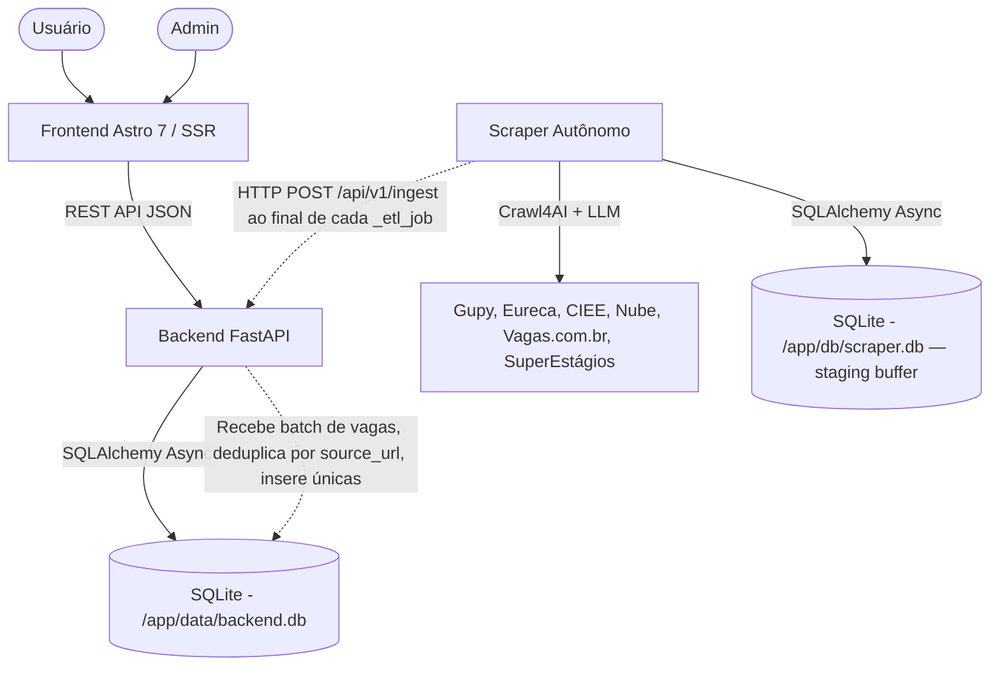

# Reestruturação Arquitetural — Scraper e Site Totalmente Separados (v4-features)

## Contexto e Problema

A arquitetura atual usa um módulo `shared/` (pacote `estagio_shared`) que acopla o **scraper** e o **backend** através de:
- Modelos SQLAlchemy compartilhados (`shared/estagio_shared/db/models.py`)
- Engine/Session de banco de dados compartilhado (`shared/estagio_shared/db/database.py`)
- Configuração compartilhada (`shared/estagio_shared/config.py`)
- Lógica ETL que grava diretamente no mesmo banco via SQLAlchemy (`shared/estagio_shared/services/etl.py`)
- Banco PostgreSQL único acessado por ambos os containers

**O objetivo** é separar completamente o scraper do site (frontend + backend), cada um com seu próprio banco SQLite, reduzindo o módulo `shared/` apenas aos enums de domínio (taxonomia).

---

## Arquitetura Proposta



### Princípios

| Aspecto | Atual | Proposto |
|:---|:---|:---|
| **Banco de dados** | PostgreSQL único, compartilhado | 2x SQLite independentes (scraper.db = staging buffer; backend.db = fonte de verdade) |
| **Acoplamento** | `shared/` instalado em ambos | `shared/` reduzido a `taxonomy.py` (enums), restante absorvido por cada módulo |
| **Comunicação** | Acesso direto ao mesmo BD | Scraper → HTTP POST → Backend (Push) |
| **Idempotência** | Sem garantia | `UNIQUE(source_url)` em `Job` no backend para retransmissões seguras |
| **Módulo shared/** | Modelos, DB, Scrapers, ETL, Taxonomia | Reduzido a `taxonomy.py` (4 enums) |
| **Deploy** | Docker Compose com 4 containers + PG | 3 containers independentes (sem PG) |
| **SQLite WAL** | N/A | `PRAGMA journal_mode=WAL` em ambos os engines para leituras não-bloqueantes |

---

## User Review Required

> [!IMPORTANT]
> **Remoção do PostgreSQL**: A troca de PostgreSQL para SQLite em ambos os lados simplifica drasticamente o deploy, mas limita concorrência de escrita. Para um agregador de vagas com volume moderado de leitura/escrita, SQLite com WAL é adequado. O `backend.db` é a fonte de verdade pós-ingest; o `scraper.db` é apenas fila de staging/retry.

> [!WARNING]
> **Breaking Change Total**: Esta reestruturação reescreve o pipeline de dados, os modelos do backend, a configuração do Docker e reduz o módulo `shared/`. Todos os dados atuais no PostgreSQL precisariam ser migrados manualmente (ou o banco seria reiniciado do zero). Os artefatos SQLite já existentes em `backend/` (`estagio.db`, `estagio1.db`, `estagio2.db`) são resquícios de dev e serão descartados — começamos do zero.

> [!IMPORTANT]
> **Alembic/Migrações**: As 4 migrações existentes em `backend/alembic/versions/` (incl. `c9f0e1234567_add_programa_estagio_to_jobarea.py`) serão descartadas e recriadas do zero para SQLite. A nova migração inicial já nasce com todas as 11 áreas em `JobArea` (incl. `PROGRAMA_ESTAGIO`), evitando o caminho incremental via `ALTER TYPE`.

---

## Decisões Resolvidas (Open Questions)

> [!IMPORTANT]
> **Q1 — Autenticação do endpoint de ingestão**: ✅ Reutilizar o `ADMIN_API_KEY` existente. Já é usado pelo `verify_admin_key` em `backend/app/core/security.py:6` para proteger rotas admin. Scraper e backend compartilham a mesma variável de ambiente no compose. Sem necessidade de `SCRAPER_API_KEY` separado.

> [!IMPORTANT]
> **Q2 — Destino do módulo shared/**: ✅ Manter `shared/` apenas com `taxonomy.py` (5 enums: `JobArea`, `JobModality`, `JobStatus`, `SourceStatus`, **`TrackingStatus`**). São ~40 linhas sem dependência de DB. Duplicar geraria drift. DB, modelos, scrapers, ETL e dedup são absorvidos individualmente por `backend/` e `scraper/`.

> [!IMPORTANT]
> **Q3 — Fluxo de sinalização**: ✅ Opção A — Push. Scraper faz `POST /api/v1/ingest` no backend ao final de cada `_etl_job`. Caminho mais simples e robusto para ETL periódico (APScheduler).

> [!NOTE]
> **Q4 — Dados existentes**: ✅ Recomeçar do zero. Os `.db` em `backend/` são dev artifacts. O PostgreSQL atual contém dados de produção mas será substituído; se houver necessidade de preservar vagas, far-se-ia um dump do PG → JSON → import no novo SQLite via endpoint `/ingest`.

> [!IMPORTANT]
> **Q5 — Fundações de features futuras na migração inicial**: ✅ Incluir na migração Alembic inicial (que já vai ser recriada do zero) as tabelas e colunas das features V1, aproveitando que ALTER TABLE no SQLite tem limitações severas. Custo marginal zero no Alembic, custo alto se adiado. Detalhado no Ajuste 12.

---

## Ajustes Incorporados (v2 + v3 + v4 + análise final)

### Ajuste 1 — `sync_to_backend` roda dentro de `_etl_job`

Local: `scraper/main.py:22-26` — função `_etl_job` atual chama só `run_pipeline()`. Após a reestrutura, ela chamará `await run_pipeline(); await sync_to_backend(...)`. O scheduler APScheduler e o health server uvicorn na porta 9090 são preservados integralmente.

### Ajuste 2 — Dependência shared é via Dockerfile, não via `-e ../shared`

O `scraper/requirements.txt` NÃO contém `-e ../shared`. A instalação de shared acontece em `scraper/Dockerfile:11,17,36-38` (`COPY shared` + `pip install /app/shared`) e idem em `backend/Dockerfile:11,17,32-35`. Após a reestrutura, ambos os Dockerfiles mantêm `COPY shared` e `pip install /app/shared` — mas `shared/` fica reduzido a `taxonomy.py` apenas.

### Ajuste 3 — `UNIQUE(source_url)` no backend para idempotência do `/ingest`

Sem essa constraint, retransmissões do scraper causariam inserção duplicada. O endpoint `POST /api/v1/ingest` deve:
- Tentar inserir cada item
- Capturar `IntegrityError` em `source_url` → classificar como duplicada
- Retornar `{ "inserted": N, "duplicated": M, "errors": [...] }`

O scraper após receber 200/207 marca o batch como `synced=True` em `scraper.db`.

### Ajuste 4 — Botão "Rodar Scrapers" mantido via proxy HTTP

- O scraper health server passa a expor `POST /run` além de `GET /health`, **com validação de `X-Admin-Key`** (P5).
- O backend substitui `POST /admin/scrapers/run` por um proxy HTTP que repassa `POST /run` ao scraper via rede interna (`scraper:9090`).
- O frontend continua chamando a mesma rota (abstração preservada).
- Os testes substituem `patch("estagio_shared.services.etl.run_pipeline")` por mock de `httpx.AsyncClient`.

### Ajuste 5 — `scraper.db` como staging buffer

O `scraper.db` NÃO é fonte de verdade. É um buffer de staging e fila de retry. A dedup no scraper atua intra-batch; a dedup canônica acontece no backend via `UNIQUE(source_url)`.

### Ajuste 6 (v3) — Paths absolutos para os SQLite

**Backend**: `DATABASE_URL=sqlite+aiosqlite:////app/data/backend.db` (path absoluto apontando para o volume `backend_data:/app/data`).

**Scraper**: `SCRAPER_DB_PATH=/app/db/scraper.db` (path absoluto, volume `scraper_data:/app/db`). O config constrói `DATABASE_URL` via property:

```python
@property
def DATABASE_URL(self) -> str:
    return f"sqlite+aiosqlite:///{self.SCRAPER_DB_PATH}"
```

### Ajuste 7 (v3) — `etl.py` usa `ScrapedJob`, não `Job`

Ao mover para `scraper/src/services/etl.py`:
- Substituir todas as 3 instâncias de `Job(...)` (linhas 74-89, 105-120, 152-167) por `ScrapedJob(...)`
- Remover: `status=JobStatus.ACTIVE`, `is_active=True`, `is_featured` (conceitos do backend)
- Adicionar: `synced=False`
- Substituir query de dedup `select(Job).where(Job.is_active == True)` por `select(ScrapedJob)` (sem filtro `is_active` que não existe no `ScrapedJob`)

### Ajuste 8 (v3) — Imports do scraper: manter `scraper/src/` como raiz

- Todos os imports usam `from src.X import ...`
- `ENV PYTHONPATH=/app/scraper` no Dockerfile
- Dockerfile: `WORKDIR /app`, `CMD ["python", "scraper/src/main.py"]`
- Imports de `estagio_shared.taxonomy.*` mantidos (enums do shared)

### Ajuste 9 (v3) — Auth no `POST /run` do scraper

O scraper valida `X-Admin-Key` contra `settings.BACKEND_API_KEY` antes de executar o pipeline:

```python
@health_app.post("/run", status_code=202)
async def trigger_run(x_admin_key: str | None = Header(default=None, alias="X-Admin-Key")):
    if not settings.BACKEND_API_KEY or x_admin_key != settings.BACKEND_API_KEY:
        raise HTTPException(status_code=401, detail="Não autorizado")
    asyncio.create_task(_etl_job())
    return {"status": "triggered", "message": "Pipeline ETL disparado"}
```

### Ajuste 10 (v3) — SQLite WAL mode no startup

Ambos os engines (backend e scraper) habilitam WAL para leituras não-bloqueantes:

```python
from sqlalchemy import event
from sqlalchemy.ext.asyncio import create_async_engine, async_sessionmaker
from sqlalchemy.pool import NullPool
from sqlalchemy.orm import declarative_base

engine = create_async_engine(
    settings.DATABASE_URL,
    echo=False,
    poolclass=NullPool,
    connect_args={"check_same_thread": False},
)

@event.listens_for(engine.sync_engine, "connect")
def _set_wal(dbapi_conn, _):
    cursor = dbapi_conn.cursor()
    cursor.execute("PRAGMA journal_mode=WAL")
    cursor.execute("PRAGMA synchronous=NORMAL")
    cursor.close()

AsyncSessionLocal = async_sessionmaker(engine, expire_on_commit=False)
Base = declarative_base()
```

> [!NOTE]
> **`NullPool`** é usado para SQLite de arquivo em produção (cada checkout cria nova conexão; com WAL, múltiplas conexões leem concorrentemente). **`StaticPool`** é reservado para testes com `:memory:` (onde a conexão única garante que o DB persiste entre checkouts).

### Ajuste 11 (v3) — Limpeza periódica do `scraper.db`

Job cron no APScheduler (`hour=3, minute=0`):

```python
async def _cleanup_job():
    cutoff = datetime.now(timezone.utc) - timedelta(days=30)
    async with AsyncSessionLocal() as session:
        result = await session.execute(
            text("DELETE FROM scraped_jobs WHERE synced = 1 AND scraped_at < :cutoff"),
            {"cutoff": cutoff}
        )
        await session.commit()
        logger.info("Cleanup: %d registros antigos removidos do scraper.db", result.rowcount)
```

### Ajuste 12 (v4) — Fundações das features futuras na migração inicial

Aproveitando que o Alembic será recriado do zero, a migração inicial já nasce com todas as estruturas que as features V1 exigem. Custo marginal na reestruturação, custo alto se adiado (ALTER TABLE no SQLite exige recriar tabela).

#### 12a — `TrackingStatus` em `shared/taxonomy.py`

```python
class TrackingStatus(str, Enum):
    SAVED = "SAVED"           # Salva, ainda não se candidatou
    APPLIED = "APPLIED"       # Inscrito
    INTERVIEW = "INTERVIEW"   # Em processo de entrevista
    OFFER = "OFFER"           # Oferta recebida
    HIRED = "HIRED"           # Contratado
    REJECTED = "REJECTED"     # Recusado
```

#### 12b — Tabelas `User` e `TrackedJob` em `backend/app/db/models.py`

Base para o tracker de candidaturas (V1). `TrackedJob.job_id` é nullable para suportar vagas externas (coladas manualmente pelo usuário).

```python
class User(Base):
    __tablename__ = "users"
    id: Mapped[uuid.UUID] = mapped_column(Uuid(as_uuid=True), primary_key=True, default=uuid.uuid4)
    email: Mapped[str] = mapped_column(String(255), unique=True, nullable=False, index=True)
    hashed_password: Mapped[str] = mapped_column(String(255), nullable=False)
    plan: Mapped[str] = mapped_column(String(20), default="free", nullable=False)  # freemium
    is_active: Mapped[bool] = mapped_column(Boolean, default=True, nullable=False)
    created_at: Mapped[datetime] = mapped_column(DateTime(timezone=True), default=utcnow, nullable=False)
    tracked_jobs = relationship("TrackedJob", back_populates="user", cascade="all, delete-orphan")

class TrackedJob(Base):
    __tablename__ = "tracked_jobs"
    id: Mapped[uuid.UUID] = mapped_column(Uuid(as_uuid=True), primary_key=True, default=uuid.uuid4)
    user_id: Mapped[uuid.UUID] = mapped_column(ForeignKey("users.id"), nullable=False, index=True)
    job_id: Mapped[uuid.UUID | None] = mapped_column(ForeignKey("jobs.id"), nullable=True)  # null = vaga externa
    # Campos para vaga colada manualmente (quando job_id é null)
    external_url: Mapped[str | None] = mapped_column(String(1000), nullable=True)
    external_title: Mapped[str | None] = mapped_column(String(255), nullable=True)
    external_company: Mapped[str | None] = mapped_column(String(255), nullable=True)
    external_logo: Mapped[str | None] = mapped_column(String(1000), nullable=True)
    # Status e notas do processo seletivo
    status: Mapped[TrackingStatus] = mapped_column(
        SQLEnum(TrackingStatus, name="trackingstatus"), default=TrackingStatus.SAVED, nullable=False
    )
    notes: Mapped[str | None] = mapped_column(Text, nullable=True)
    tracked_at: Mapped[datetime] = mapped_column(DateTime(timezone=True), default=utcnow, nullable=False)
    updated_at: Mapped[datetime] = mapped_column(DateTime(timezone=True), default=utcnow, nullable=False)
    user = relationship("User", back_populates="tracked_jobs")
    job = relationship("Job")
```

#### 12c — Colunas extras em `Job` (campos enriquecidos pelo scraper — V1+)

Colunas `nullable=True` para serem populadas gradualmente por cada scraper. Não há valor default a preencher — campos ausentes simplesmente ficam null até o scraper ser melhorado.

```python
# Adicionar ao modelo Job existente:
benefits: Mapped[str | None] = mapped_column(Text, nullable=True)
requirements: Mapped[str | None] = mapped_column(Text, nullable=True)
deadline: Mapped[datetime | None] = mapped_column(DateTime(timezone=True), nullable=True)
is_pcd: Mapped[bool] = mapped_column(Boolean, default=False, nullable=False)
contract_type: Mapped[str | None] = mapped_column(String(50), nullable=True)  # "estágio", "trainee"
duration_months: Mapped[int | None] = mapped_column(Integer, nullable=True)
closed_at: Mapped[datetime | None] = mapped_column(DateTime(timezone=True), nullable=True)  # Para detecção de vaga encerrada
salary_min_cents: Mapped[int | None] = mapped_column(Integer, nullable=True)  # Para filtro por faixa salarial
salary_max_cents: Mapped[int | None] = mapped_column(Integer, nullable=True)
```

#### 12d — Tabela FTS5 na migração Alembic (DDL raw)

O SQLite FTS5 não é suportado pelo Alembic autogenerate. Deve ser adicionado via `op.execute()` no arquivo de migração. Os triggers mantêm o índice sincronizado automaticamente.

```python
# No arquivo de migração gerado (backend/alembic/versions/xxxx_initial_sqlite_schema.py)
def upgrade():
    # ... tabelas geradas pelo autogenerate ...

    # FTS5 para full-text search em vagas
    op.execute("""
        CREATE VIRTUAL TABLE IF NOT EXISTS jobs_fts USING fts5(
            title, company, description, location,
            content=jobs, content_rowid=rowid
        )
    """)
    op.execute("""
        CREATE TRIGGER IF NOT EXISTS jobs_fts_insert
        AFTER INSERT ON jobs BEGIN
            INSERT INTO jobs_fts(rowid, title, company, description, location)
            VALUES (new.rowid, new.title, new.company, new.description, new.location);
        END
    """)
    op.execute("""
        CREATE TRIGGER IF NOT EXISTS jobs_fts_delete
        AFTER DELETE ON jobs BEGIN
            INSERT INTO jobs_fts(jobs_fts, rowid, title, company, description, location)
            VALUES('delete', old.rowid, old.title, old.company, old.description, old.location);
        END
    """)
    op.execute("""
        CREATE TRIGGER IF NOT EXISTS jobs_fts_update
        AFTER UPDATE ON jobs BEGIN
            INSERT INTO jobs_fts(jobs_fts, rowid, title, company, description, location)
            VALUES('delete', old.rowid, old.title, old.company, old.description, old.location);
            INSERT INTO jobs_fts(rowid, title, company, description, location)
            VALUES (new.rowid, new.title, new.company, new.description, new.location);
        END
    """)

def downgrade():
    op.execute("DROP TRIGGER IF EXISTS jobs_fts_update")
    op.execute("DROP TRIGGER IF EXISTS jobs_fts_delete")
    op.execute("DROP TRIGGER IF EXISTS jobs_fts_insert")
    op.execute("DROP TABLE IF EXISTS jobs_fts")
    # ... restante do downgrade gerado pelo autogenerate ...
```

> [!NOTE]
> O modelo `Job` usa `UUID` como PK. O FTS5 usa `rowid` (INTEGER interno do SQLite). O SQLAlchemy com `NullPool` no SQLite expõe `rowid` implicitamente via ORM — não é necessário adicionar coluna extra. A query FTS5 usa `rowid` para fazer JOIN com a tabela `jobs` via `content=jobs, content_rowid=rowid`.

#### 12e — CORS aberto para escrita em `backend/app/main.py`

O tracker e o endpoint de cliques precisam de POST/PATCH/DELETE a partir do cliente:

```diff
-    allow_methods=["GET"],
+    allow_methods=["GET", "POST", "PATCH", "DELETE"],
+    allow_credentials=True,
```

#### 12f — Dependências de auth em `backend/requirements.txt`

Adicionadas agora para não forçar rebuild de imagem Docker na V1:

```
passlib[bcrypt]>=1.7.4
python-jose[cryptography]>=3.3.0
beautifulsoup4>=4.12.0   # Para extração de OG tags (vaga manual no tracker)
lxml>=5.2.0              # Parser para BeautifulSoup
```

#### 12g — Endpoint `POST /api/v1/expire` em `backend/app/api/v1/endpoints/ingest.py`

Endpoint para o scraper notificar o backend sobre vagas encerradas (job cron do scraper faz HEAD requests e reporta URLs mortas):

```python
class ExpireRequest(BaseModel):
    expired_urls: list[str]

@router.post("/expire", dependencies=[Depends(verify_admin_key)])
async def expire_jobs(
    request: ExpireRequest,
    db: AsyncSession = Depends(get_db)
):
    result = await db.execute(
        update(Job)
        .where(Job.source_url.in_(request.expired_urls), Job.is_active == True)
        .values(
            is_active=False,
            status=JobStatus.CLOSED,
            closed_at=datetime.now(timezone.utc)
        )
    )
    await db.commit()
    return {"expired": result.rowcount}
```

#### 12h — Novo job de verificação de URLs no scraper

Novo arquivo `scraper/src/services/health_check.py` com verificação de URLs por HTTP HEAD (10 concorrentes, timeout 10s). Integrado ao `main.py` como cron diário às 03:30 UTC.

```python
# scraper/src/services/health_check.py
async def check_expired_urls(urls: list[str], concurrency: int = 10) -> list[str]:
    """Retorna URLs que retornam 404/410 ou redirect para domínio diferente."""
    expired = []
    semaphore = asyncio.Semaphore(concurrency)

    async def _check(url: str):
        async with semaphore:
            try:
                async with httpx.AsyncClient(timeout=10, follow_redirects=False) as client:
                    resp = await client.head(url)
                    if resp.status_code in (404, 410, 403):
                        expired.append(url)
                    elif resp.status_code in (301, 302):
                        location = resp.headers.get("location", "")
                        if urlparse(location).netloc != urlparse(url).netloc:
                            expired.append(url)  # Redirect para domínio diferente = vaga removida
            except (httpx.ConnectError, httpx.TimeoutException):
                pass  # Timeout não é expiração confirmada

    await asyncio.gather(*[_check(url) for url in urls])
    return expired
```

Integração em `scraper/src/main.py`:

```python
# Adicionado ao _check_expired_job() e ao scheduler:
async def _check_expired_job():
    async with AsyncSessionLocal() as session:
        result = await session.execute(
            text("SELECT DISTINCT source_url FROM scraped_jobs WHERE synced = 1")
        )
        urls = [row[0] for row in result]
    if not urls:
        return
    expired = await check_expired_urls(urls)
    if expired:
        await sync_expirations(settings.BACKEND_URL, settings.BACKEND_API_KEY, expired)
        logger.info("Expiração: %d vagas marcadas como encerradas", len(expired))

# No scheduler (junto ao _cleanup_job e _etl_job):
scheduler.add_job(_check_expired_job, CronTrigger(hour=3, minute=30))
```

#### 12i — `sync_expirations()` em `scraper/src/services/sync.py`

```python
async def sync_expirations(backend_url: str, api_key: str, expired_urls: list[str]):
    """Notifica o backend sobre URLs de vagas encerradas."""
    async with httpx.AsyncClient(timeout=30.0) as client:
        try:
            resp = await client.post(
                f"{backend_url}/api/v1/expire",
                json={"expired_urls": expired_urls},
                headers={"X-Admin-Key": api_key}
            )
            resp.raise_for_status()
            data = resp.json()
            logger.info("sync_expirations: %d vagas expiradas no backend", data.get("expired", 0))
        except httpx.HTTPError as exc:
            logger.error("Falha ao sincronizar expirações: %s", exc)
```

#### 12j — Endpoint `POST /api/v1/jobs/{job_id}/click` em `backend/app/api/v1/endpoints/jobs.py`

Tracking de cliques por vaga (analytics). A tabela `JobClick` já existe e será preservada.

```python
@router.post("/{job_id}/click", status_code=204)
@limiter.limit("30/minute")
async def register_click(
    request: Request,
    job_id: UUID,
    db: AsyncSession = Depends(get_db)
):
    job = await db.scalar(select(Job).where(Job.id == job_id, Job.is_active == True))
    if not job:
        raise HTTPException(status_code=404, detail="Vaga não encontrada")
    click = JobClick(
        job_id=job_id,
        referrer=request.headers.get("referer", "")[:255]
    )
    db.add(click)
    await db.commit()
```

> [!NOTE]
> O `JobClick` já está no modelo atual e será movido para `backend/app/db/models.py` no commit 1. Este endpoint é a peça que faltava para fechar o loop de analytics por vaga.

---

## Proposed Changes

### 1. Scraper (módulo independente)

O scraper se torna completamente autônomo com seu próprio banco, modelos e lógica.

#### MODIFY `scraper/src/main.py` (movido de `scraper/main.py`)

- Remover import de `estagio_shared.config`
- Importar módulos locais: `from src.config import settings`, `from src.services.etl import run_pipeline`, `from src.services.sync import sync_to_backend`
- `_etl_job()` passa a chamar `await run_pipeline(); await sync_to_backend(settings.BACKEND_URL, settings.BACKEND_API_KEY)`
- Health server expandido: `POST /run` com validação `X-Admin-Key` (Ajuste 9)
- `_cleanup_job()` adicionado ao scheduler (Ajuste 11)
- APScheduler e loop principal preservados

#### NEW `scraper/src/db/database.py`

- Engine SQLite async: `sqlite+aiosqlite:///{SCRAPER_DB_PATH}` (path absoluto, Ajuste 6)
- `NullPool` + WAL pragma (Ajuste 10)
- `Base`, `AsyncSessionLocal`, `get_db()` próprios

#### NEW `scraper/src/db/models.py`

- Modelo `ScrapedJob`: espelho simplificado dos campos de Job + `synced: bool = False`
- Modelo `Source` local (idêntico ao atual)
- Importar enums de `estagio_shared.taxonomy`

#### MOVE `shared/estagio_shared/services/scrapers/` → `scraper/src/scrapers/`

- `gupy.py`, `eureca.py`, `estagios.py`, `crawl4ai_scraper.py`, `rules_manager.py`
- Adaptar imports: `estagio_shared.services.scrapers.gupy` → `src.scrapers.gupy`
- Manter imports de `estagio_shared.taxonomy` (enums)

#### MOVE `shared/estagio_shared/services/` → `scraper/src/services/`

- `etl.py`: grava `ScrapedJob` no SQLite local (Ajuste 7). Query dedup: `select(ScrapedJob)` sem filtro `is_active`
- `dedup.py`: idêntico (dedup intra-batch)
- `extractor.py`: imports de `estagio_shared.config` → `src.config`, `estagio_shared.services.scrapers.*` → `src.scrapers.*`
- `job_validator.py`: idêntico (mantém `estagio_shared.taxonomy.JobModality`)

#### NEW `scraper/src/services/sync.py`

```python
async def sync_to_backend(backend_url: str, api_key: str, batch_size: int = 100):
    # Seleciona ScrapedJob com synced == False
    # Serializa como JSON (IngestJobItem compatível)
    # POST {backend_url}/api/v1/ingest com header X-Admin-Key
    # Sucesso → marca synced = True (mesmo as classificadas como duplicated)
    # Erro HTTP/timeout → NÃO marca synced (permanece na fila)
```

#### NEW `scraper/src/config.py`

```python
class ScraperSettings(BaseSettings):
    SCRAPER_DB_PATH: str = "/app/db/scraper.db"
    BACKEND_URL: str = "http://backend:8000"
    BACKEND_API_KEY: str = ""
    LLM_PROVIDER: str = "groq"
    LLM_MODEL: str = "llama-3.1-8b-instant"
    GROQ_API_KEY: SecretStr | None = None
    OPENAI_API_KEY: SecretStr | None = None
    GEMINI_API_KEY: SecretStr | None = None
    OPENROUTER_API_KEY: SecretStr | None = None
    ETL_INTERVAL_HOURS: int = 6
    RULES_FILE: str | None = None

    @property
    def DATABASE_URL(self) -> str:
        return f"sqlite+aiosqlite:///{self.SCRAPER_DB_PATH}"

    model_config = SettingsConfigDict(env_file=".env", env_ignore_empty=True, extra="ignore")
```

#### MODIFY `scraper/requirements.txt`

- Remover `asyncpg>=0.29.0` (não precisa mais de PG)
- Manter `aiosqlite>=0.20.0`
- Manter sem `-e ../shared` (instalação via Dockerfile)

#### MODIFY `scraper/Dockerfile`

- Manter `COPY shared /app/shared` + `pip install /app/shared` (taxonomy.py)
- Remover `libpq-dev` (builder) e `libpq5` (runtime)
- Adicionar `ENV PYTHONPATH=/app/scraper`
- `CMD ["python", "scraper/src/main.py"]`
- Volume `scraper_data:/app/db` para persistir `scraper.db`

#### Mapa completo de imports adaptados (21 referências em 8 arquivos)

| Arquivo | Import atual | Import novo |
|:---|:---|:---|
| `etl.py:4` | `estagio_shared.db.database.AsyncSessionLocal` | `src.db.database.AsyncSessionLocal` |
| `etl.py:5` | `estagio_shared.db.models.Job, Source, SourceStatus` | `src.db.models.ScrapedJob, Source` + `estagio_shared.taxonomy.SourceStatus` |
| `etl.py:6` | `estagio_shared.services.scrapers.gupy.run_gupy_scraper` | `src.scrapers.gupy.run_gupy_scraper` |
| `etl.py:7` | `estagio_shared.services.scrapers.eureca.run_eureca_scraper` | `src.scrapers.eureca.run_eureca_scraper` |
| `etl.py:8` | `estagio_shared.services.scrapers.estagios.scrape_secondary_platforms` | `src.scrapers.estagios.scrape_secondary_platforms` |
| `etl.py:9` | `estagio_shared.services.dedup.is_duplicate` | `src.services.dedup.is_duplicate` |
| `etl.py:10` | `estagio_shared.services.job_validator.*` | `src.services.job_validator.*` |
| `etl.py:11` | `estagio_shared.taxonomy.JobStatus` | **Removido** (P3 — `status=` não existe no ScrapedJob) |
| `gupy.py:5` | `estagio_shared.taxonomy.JobArea, JobModality` | **Mantém** |
| `gupy.py:6` | `estagio_shared.services.job_validator.trunc` | `src.services.job_validator.trunc` |
| `gupy.py:130` | `estagio_shared.services.job_validator.parse_salary` | `src.services.job_validator.parse_salary` |
| `gupy.py:179` | `estagio_shared.services.job_validator.validate_job, safe_str` | `src.services.job_validator.validate_job, safe_str` |
| `eureca.py:5` | `estagio_shared.taxonomy.JobArea, JobModality` | **Mantém** |
| `eureca.py:6` | `estagio_shared.services.scrapers.gupy._guess_area` | `src.scrapers.gupy._guess_area` |
| `eureca.py:7` | `estagio_shared.services.job_validator.trunc` | `src.services.job_validator.trunc` |
| `eureca.py:77` | `estagio_shared.services.job_validator.parse_salary` | `src.services.job_validator.parse_salary` |
| `eureca.py:109` | `estagio_shared.services.job_validator.validate_job, safe_str` | `src.services.job_validator.validate_job, safe_str` |
| `estagios.py:6` | `estagio_shared.services.extractor.process_job_url` | `src.services.extractor.process_job_url` |
| `estagios.py:7` | `estagio_shared.config.settings` | `src.config.settings` |
| `estagios.py:8` | `estagio_shared.taxonomy.JobArea, JobModality` | **Mantém** |
| `extractor.py:10` | `estagio_shared.config.settings` | `src.config.settings` |
| `extractor.py:11` | `estagio_shared.taxonomy.JobArea, JobModality` | **Mantém** |
| `extractor.py:12` | `estagio_shared.services.scrapers.rules_manager.*` | `src.scrapers.rules_manager.*` |
| `extractor.py:128` | `estagio_shared.services.scrapers.gupy._guess_area, _map_modality` | `src.scrapers.gupy._guess_area, _map_modality` |
| `job_validator.py:8` | `estagio_shared.taxonomy.JobModality` | **Mantém** |

**Resumo**: 7 mantêm `estagio_shared.taxonomy.*`, 14 mudam para `src.*`, 1 removido.

---

### 2. Backend (API do site)

O backend se torna independente com seu próprio SQLite e recebe vagas via endpoint de ingestão idempotente.

#### NEW `backend/app/db/database.py`

- Engine SQLite async: `sqlite+aiosqlite:////app/data/backend.db` (path absoluto, Ajuste 6)
- `NullPool` + WAL pragma (Ajuste 10)
- `Base`, `AsyncSessionLocal`, `get_db()` próprios

#### MOVE `shared/estagio_shared/db/models.py` → `backend/app/db/models.py`

- Modelos `Job`, `Source`, `JobClick` mantidos
- `Job.source_url`: `String(1000), nullable=False, unique=True` (Ajuste 3)
- **Novos modelos**: `User`, `TrackedJob` (Ajuste 12b)
- **Novas colunas em `Job`**: `benefits`, `requirements`, `deadline`, `is_pcd`, `contract_type`, `duration_months`, `closed_at`, `salary_min_cents`, `salary_max_cents` — todas `nullable=True` (Ajuste 12c)
- **Import adicional**: `from estagio_shared.taxonomy import TrackingStatus` (Ajuste 12a)
- Importar enums de `estagio_shared.taxonomy` (preservado)

#### NÃO criar `backend/app/db/enums.py`

Decisão Q2 — enums ficam em `shared/taxonomy.py`. Imports `from estagio_shared.taxonomy import ...` preservados.

#### NEW `backend/app/api/v1/endpoints/ingest.py`

- `POST /api/v1/ingest` protegido por `verify_admin_key`
- Recebe `IngestRequest` (lista de `IngestJobItem`)
- Fluxo:
  1. Validar `JobArea`/`JobModality` como strings válidas
  2. Dedup via `find_existing_urls()` (query `IN`) — evita N queries
  3. Criar `Job` com `is_active=True`, `is_featured=False`, `status=ACTIVE`
  4. `get_or_create` de `Source` a partir de `source_name`
  5. `try/except IntegrityError` por item (race em batch concorrente)
  6. Commit final
- Retornar `IngestResponse { inserted, duplicated, errors }`
- Registrar em `api.py`: `api_router.include_router(ingest.router, prefix="/ingest", tags=["ingest"])`

#### NEW `backend/app/schemas/ingest.py`

- `IngestJobItem(BaseModel)`: title, company, location?, modality, area, description?, salary?, salary_min_cents?, salary_max_cents?, company_logo?, source_url, source_id, posted_at?, source_name?, benefits?, requirements?, deadline?, is_pcd?, contract_type?, duration_months? **(Ajuste 12c)**
- `IngestRequest(BaseModel)`: items: `List[IngestJobItem]`
- `IngestResponse(BaseModel)`: inserted: int, duplicated: int, errors: `List[str]`
- **Novo**: `ExpireRequest(BaseModel)`: expired_urls: `List[str]` **(Ajuste 12g)**

#### NEW `backend/app/services/dedup.py`

- `find_existing_urls(session, urls: list[str]) -> set[str]` — query única `select(Job.source_url).where(Job.source_url.in_(urls))`
- Sem `rapidfuzz` no backend (dedup via SQL UNIQUE)

#### MODIFY `backend/app/core/config.py`

- `DATABASE_URL: str = "sqlite+aiosqlite:////app/data/backend.db"`
- Adicionar `SCRAPER_URL: str = "http://scraper:9090"`
- Manter `CORS_ORIGINS`, `ADMIN_API_KEY`, `PROJECT_NAME`, `API_V1_STR`

#### MODIFY `backend/requirements.txt`

- Manter `-e ../shared` (para `taxonomy.py`)
- Remover `asyncpg==0.29.0`
- Adicionar `aiosqlite>=0.20.0`
- Não adicionar `rapidfuzz` (dedup via SQL)
- `httpx==0.27.0` já presente (usado pelo proxy e pelos testes)

#### MODIFY imports em `backend/app/`

- `endpoints/jobs.py:9-12`: `estagio_shared.db.database.get_db` → `app.db.database.get_db`; `estagio_shared.db.models.Job` → `app.db.models.Job`; `estagio_shared.taxonomy.*` → **mantém**
- `endpoints/admin.py:6-8`: `estagio_shared.db.*` → `app.db.*`
- `schemas/job.py:6`: `estagio_shared.taxonomy.*` → **mantém**
- `tests/conftest.py:10-12`: `estagio_shared.db.*` → `app.db.*`; `estagio_shared.taxonomy.*` → **mantém**
- `tests/api/test_admin.py:4,28`: `estagio_shared.db.models.Job` → `app.db.models.Job`; `patch("estagio_shared.services.etl.run_pipeline")` → mock de `httpx.AsyncClient`
- `tests/test_models.py:1`: `estagio_shared.taxonomy` → **mantém**

#### MODIFY `backend/app/api/v1/endpoints/admin.py` — `/scrapers/run` vira proxy

```python
@router.post("/scrapers/run", response_model=ScraperRunResponse, status_code=202)
async def run_scrapers():
    async with httpx.AsyncClient(timeout=15.0) as client:
        try:
            resp = await client.post(
                f"{settings.SCRAPER_URL}/run",
                headers={"X-Admin-Key": settings.ADMIN_API_KEY}
            )
        except httpx.HTTPError:
            raise HTTPException(status_code=502, detail="Scraper indisponível")
    return ScraperRunResponse(message="Pipeline de scrapers disparado", status="triggered")
```

#### DELETE `backend/scripts/wait_for_db.py`

Com SQLite, não há dependência TCP a aguardar. CMD muda para: `alembic upgrade head && uvicorn app.main:app --host 0.0.0.0 --port 8000`.

Testes `test_wait_for_db.py` também descartados.

#### MODIFY `backend/Dockerfile`

- Manter `COPY shared /app/shared` + `pip install /app/shared` (taxonomy.py)
- Remover `libpq-dev` (builder) e `libpq5` (runtime)
- CMD: `["sh", "-c", "alembic upgrade head && uvicorn app.main:app --host 0.0.0.0 --port 8000"]`
- Volume `backend_data:/app/data` para persistir `backend.db`

#### MODIFY Alembic

- Descartar os 4 arquivos em `backend/alembic/versions/`
- `alembic/env.py:14-15`: trocar `estagio_shared.db.database.Base` → `app.db.database.Base`; `estagio_shared.db.models` → `app.db.models`
- Nova migração inicial via `alembic revision --autogenerate -m "initial sqlite schema"` com:
  - `Job.source_url` como `String(1000), unique=True, nullable=False`
  - Todos os enums completos desde o nascimento
  - Tabelas `User` e `TrackedJob` **(Ajuste 12b)**
  - Colunas extras no `Job`: `benefits`, `requirements`, `deadline`, `is_pcd`, `contract_type`, `duration_months`, `closed_at`, `salary_min_cents`, `salary_max_cents` **(Ajuste 12c)**
  - DDL raw para tabela FTS5 `jobs_fts` + 3 triggers de sync **(Ajuste 12d)** — adicionados via `op.execute()` após o bloco do autogenerate

---

### 3. Frontend (mudanças mínimas)

O frontend já é independente — comunica-se só via HTTP.

#### MODIFY `frontend/src/lib/api.ts`

- Nenhuma mudança necessária (já usa HTTP puro)

#### MODIFY `frontend/src/pages/admin/api/scrapers/run.astro`

- Nenhuma mudança estrutural — o backend agora faz proxy HTTP ao scraper, mas o frontend não sabe

#### MODIFY `frontend/src/components/AdminDashboard.astro`

- Nenhuma mudança — botão e toast de erro já cobrem o cenário de scraper offline (HTTP 502)

---

### 4. Docker Compose

#### MODIFY `docker-compose.yml`

```yaml
name: estagio

services:
  backend:
    build:
      context: .
      dockerfile: backend/Dockerfile
    command: sh -c "alembic upgrade head && uvicorn app.main:app --host 0.0.0.0 --port 8000"
    ports:
      - "${BACKEND_PORT:-8001}:8000"
    environment:
      - DATABASE_URL=sqlite+aiosqlite:////app/data/backend.db
      - CORS_ORIGINS=${CORS_ORIGINS}
      - ADMIN_API_KEY=${ADMIN_API_KEY:-changeme}
      - SCRAPER_URL=http://scraper:9090
    volumes:
      - backend_data:/app/data
    healthcheck:
      test: ["CMD", "curl", "-f", "http://localhost:8000/health"]
      interval: 15s
      timeout: 5s
      retries: 5
      start_period: 30s
    restart: always
    networks:
      - estagio_net

  frontend:
    build:
      context: .
      dockerfile: frontend/Dockerfile
    command: node ./dist/server/entry.mjs
    environment:
      - BACKEND_URL=http://backend:8000
      - HOST=0.0.0.0
      - PORT=4321
      - ADMIN_API_KEY=${ADMIN_API_KEY:-changeme}
      - ADMIN_PASSWORD=${ADMIN_PASSWORD:-changeme_admin_password}
      - ADMIN_SECRET=${ADMIN_SECRET:-generate_a_long_random_secret_here_minimum_32_chars}
    ports:
      - "${FRONTEND_PORT:-4321}:4321"
    depends_on:
      backend:
        condition: service_healthy
    restart: always
    networks:
      - estagio_net
      - dokploy-network

  scraper:
    build:
      context: .
      dockerfile: scraper/Dockerfile
    depends_on:
      backend:
        condition: service_healthy
    environment:
      - SCRAPER_DB_PATH=/app/db/scraper.db
      - BACKEND_URL=http://backend:8000
      - BACKEND_API_KEY=${ADMIN_API_KEY:-changeme}
      - LLM_PROVIDER=${LLM_PROVIDER:-groq}
      - LLM_MODEL=${LLM_MODEL:-llama-3.1-8b-instant}
      - GROQ_API_KEY=${GROQ_API_KEY}
      - OPENAI_API_KEY=${OPENAI_API_KEY}
      - GEMINI_API_KEY=${GEMINI_API_KEY}
      - OPENROUTER_API_KEY=${OPENROUTER_API_KEY}
      - ETL_INTERVAL_HOURS=${ETL_INTERVAL_HOURS:-6}
      - RULES_FILE=/app/data/scraper_rules.json
    volumes:
      - scraper_rules:/app/data
      - scraper_data:/app/db
    restart: always
    networks:
      - estagio_net

volumes:
  backend_data:
  scraper_rules:
  scraper_data:

networks:
  estagio_net:
    driver: bridge
  dokploy-network:
    external: true
```

**Mudanças-chave**:
- ❌ Removido serviço `db` (PostgreSQL) e volume `postgres_data`
- ❌ Removido `depends_on: db` do backend e do scraper
- ✅ `backend_data` volume para `backend.db`
- ✅ `scraper_data` volume para `scraper.db` (staging buffer)
- ✅ Scraper faz `depends_on: backend` (precisa do backend para `POST /ingest`)
- ✅ `SCRAPER_URL` injetado no backend para proxy de `POST /run`
- ✅ Paths absolutos nos `DATABASE_URL` e `SCRAPER_DB_PATH`

---

### 5. Módulo Shared

#### MODIFY `shared/`

**Manter apenas**:
- `shared/estagio_shared/__init__.py`
- `shared/estagio_shared/taxonomy.py` (~40 linhas — **5 enums**, incluindo `TrackingStatus` do Ajuste 12a)
- `shared/pyproject.toml` (atualizado)

**Remover**:
- `shared/estagio_shared/config.py`
- `shared/estagio_shared/db/`
- `shared/estagio_shared/services/`

#### DELETE `scraper-list-link/`

Diretório residual, não referenciado. Remover como limpeza.

---

## Estrutura Final

```text
estagio.io/
├── backend/                      # API REST (FastAPI + SQLite)
│   ├── app/
│   │   ├── api/v1/endpoints/
│   │   │   ├── jobs.py
│   │   │   ├── admin.py          # /scrapers/run vira proxy HTTP ao scraper:9090
│   │   │   └── ingest.py         # [NEW] POST idempotente
│   │   ├── core/
│   │   │   ├── config.py         # default SQLite + SCRAPER_URL
│   │   │   ├── security.py
│   │   │   └── rate_limit.py
│   │   ├── db/
│   │   │   ├── database.py       # [NEW] Engine SQLite + WAL + NullPool
│   │   │   └── models.py         # [MOVED] Job.source_url UNIQUE
│   │   ├── schemas/
│   │   │   ├── job.py
│   │   │   ├── admin.py
│   │   │   └── ingest.py         # [NEW]
│   │   ├── services/
│   │   │   └── dedup.py          # [NEW] find_existing_urls()
│   │   └── main.py
│   ├── alembic/                  # Recriado p/ SQLite
│   ├── tests/
│   ├── scripts/                  # [DELETE wait_for_db.py]
│   └── requirements.txt
│
├── frontend/                     # Astro 7 (sem mudanças estruturais)
│   └── src/
│
├── scraper/                      # Scraper autônomo (Python + SQLite)
│   ├── src/                      # Raiz do pacote (PYTHONPATH=/app/scraper)
│   │   ├── config.py             # [NEW]
│   │   ├── main.py               # [MOVED] _etl_job + sync + /run + cleanup + _check_expired_job
│   │   ├── db/
│   │   │   ├── database.py       # [NEW] Engine SQLite + WAL + NullPool
│   │   │   └── models.py         # [NEW] ScrapedJob (synced) + Source
│   │   ├── scrapers/             # [MOVED de shared/services/scrapers/]
│   │   │   ├── gupy.py
│   │   │   ├── eureca.py
│   │   │   ├── estagios.py
│   │   │   ├── crawl4ai_scraper.py
│   │   │   └── rules_manager.py
│   │   └── services/
│   │       ├── etl.py            # [MOVED] ScrapedJob + synced=False
│   │       ├── dedup.py          # [MOVED]
│   │       ├── extractor.py      # [MOVED]
│   │       ├── job_validator.py  # [MOVED]
│   │       ├── sync.py           # [NEW] sync_to_backend() + sync_expirations()
│   │       └── health_check.py   # [NEW] check_expired_urls() — Ajuste 12h
│   ├── tests/
│   ├── Dockerfile
│   └── requirements.txt
│
├── shared/                       # [REDUCED] Só taxonomy.py (5 enums)
│   ├── pyproject.toml
│   └── estagio_shared/
│       ├── __init__.py
│       └── taxonomy.py           # JobArea, JobModality, JobStatus, SourceStatus, TrackingStatus
│
├── docker-compose.yml            # Sem PG, paths absolutos, volumes
├── .env.example                  # Sem POSTGRES_PASSWORD
└── README.md
```

---

## Verification Plan

### Testes automatizados

```bash
# Backend — usa SQLite :memory: nos testes (conftest.py já é sqlite+aiosqlite)
cd backend
pip install -r requirements.txt
python -m pytest tests/ -v

# Scraper — adaptar conftest para usar scraper.db local
cd scraper
pip install -r requirements.txt
python -m pytest tests/ -v

# Frontend (sem mudanças)
cd frontend
npm test
```

### Testes novos a adicionar

**`backend/tests/api/test_ingest.py`**:
- `test_ingest_unauthorized` (sem X-Admin-Key → 401)
- `test_ingest_inserts_new_job`
- `test_ingest_inserts_job_with_extra_fields` (benefits, requirements, deadline, is_pcd)
- `test_ingest_dedup_by_source_url` (2x mesmo batch → segunda retorna duplicated=1)
- `test_ingest_invalid_area_returns_error`
- `test_ingest_creates_source_if_missing`
- `test_expire_unauthorized` (sem X-Admin-Key → 401) **(Ajuste 12g)**
- `test_expire_marks_jobs_inactive` **(Ajuste 12g)**
- `test_expire_ignores_already_inactive` **(Ajuste 12g)**

**`backend/tests/api/test_jobs.py`** (adicionar):
- `test_register_click_success` (POST /jobs/{id}/click → 204) **(Ajuste 12j)**
- `test_register_click_not_found` (→ 404)
- `test_register_click_rate_limited` (> 30/min → 429)

**`backend/tests/api/test_admin.py`** (modificar):
- `test_scrapers_run_proxies_to_scraper` (mock `httpx.AsyncClient.post`)
- `test_scrapers_run_returns_502_on_scraper_unavailable`

**`backend/tests/test_database.py`** (novo):
- `test_wal_mode_enabled` (PRAGMA journal_mode retorna `wal`)
- `test_fts5_table_exists` (SELECT name FROM sqlite_master WHERE type='table' AND name='jobs_fts')
- `test_fts5_triggers_exist` (verifica os 3 triggers) **(Ajuste 12d)**
- `test_fts5_indexes_job_on_insert` (INSERT job → FTS5 atualiza) **(Ajuste 12d)**

**`backend/tests/test_models.py`** (adicionar):
- `test_user_model_creates_correctly`
- `test_tracked_job_with_internal_job`
- `test_tracked_job_with_external_url` (job_id=None)
- `test_tracked_job_status_enum_values` **(Ajuste 12b)**

**`scraper/tests/test_sync.py`**:
- `test_sync_to_backend_marks_synced_on_success`
- `test_sync_to_backend_does_not_mark_on_http_error`
- `test_sync_to_backend_sends_correct_payload`
- `test_sync_expirations_sends_correct_payload` **(Ajuste 12i)**
- `test_sync_expirations_handles_http_error` **(Ajuste 12i)**

**`scraper/tests/test_health_check.py`** (novo):
- `test_check_expired_urls_marks_404` **(Ajuste 12h)**
- `test_check_expired_urls_marks_410` **(Ajuste 12h)**
- `test_check_expired_urls_ignores_timeout` (timeout não é expiração confirmada)
- `test_check_expired_urls_marks_redirect_to_different_domain` **(Ajuste 12h)**

**`scraper/tests/test_main.py`**:
- `test_run_endpoint_requires_auth` (POST /run sem header → 401)
- `test_run_endpoint_accepts_valid_key` (→ 202)
- `test_run_endpoint_rejects_wrong_key` (→ 401)
- `test_cleanup_job_deletes_old_synced`
- `test_check_expired_job_calls_sync_expirations` **(Ajuste 12h)**

### Verificação manual

1. **Scraper isolado**: `python scraper/src/main.py` → `scraper.db` criado com vagas `synced=0`
2. **Ingestão automática**: Scraper finaliza → sync → `scraper.db` mostra `synced=1` → `backend.db` contém vagas
3. **Idempotência**: Reiniciar scraper com `synced=1` → sync não encontra nada
4. **Idempotência regressiva**: Resetar `synced` de N registros → sync → backend responde `duplicated=N`, `inserted=0`
5. **API pública**: `GET /api/v1/jobs` retorna as vagas ingeridas
6. **Botão admin**: Clicar → backend proxia → scraper roda → novas vagas
7. **Scraper offline**: Parar scraper → clicar → toast "Falha ao disparar scrapers" (502)
8. **Docker Compose**: `docker compose up --build` → 3 containers saudáveis sem PG
9. **WAL**: Sob carga, GET /jobs responde sem "database is locked" durante escrita do /ingest
10. **Cleanup**: Registros `synced=1` com `scraped_at` >30d são removidos às 03:00

---

## Ordem de Execução (11 commits)

```
1. feat(backend): migra para SQLite local com WAL e fundacoes V1
   → DB local + modelos (Job.source_url UNIQUE + 9 colunas extras + User + TrackedJob)
     + NullPool + WAL pragma + CORS aberto + deps de auth + testes ajustados
   INCLUI: Ajustes 3, 6, 10, 12b, 12c, 12e, 12f

2. feat(backend): adiciona endpoint de ingestao idempotente
   → /ingest + /expire + schemas (IngestJobItem com campos extras + ExpireRequest)
     + services/dedup + testes
   INCLUI: Ajuste 12g

3. feat(backend): /scrapers/run vira proxy ao scraper
   → admin.py proxy HTTP + testes com mock httpx

4. feat(backend): adiciona tracking de cliques por vaga
   → POST /jobs/{id}/click + testes
   INCLUI: Ajuste 12j

5. feat(backend): adiciona FTS5 para full-text search
   → Migração Alembic com DDL raw (jobs_fts + 3 triggers) + testes
   INCLUI: Ajuste 12d
   (separado do commit 1 para facilitar rollback se FTS5 causar problema)

6. feat(scraper): migra para SQLite local com staging buffer
   → DB local + ScrapedJob (synced) + NullPool + WAL + config + testes

7. refactor(scraper): absorve logica de shared
   → mover scrapers e serviços para src/{scrapers,services}/ + adaptar imports

8. feat(scraper): adiciona sync_to_backend e sync_expirations
   → services/sync.py (sync_to_backend + sync_expirations) + services/health_check.py + testes
   INCLUI: Ajustes 12h, 12i

9. feat(scraper): integra sync ao pipeline, expoe /run e verifica vagas encerradas
   → main.py com _etl_job+sync+/run+auth+cleanup+_check_expired_job + testes
   INCLUI: Ajuste 12h (cron às 03:30)

10. refactor: reduz shared a taxonomy (5 enums) e ajusta infra
    → shared/ reduzido + TrackingStatus + Dockerfiles + compose sem PG + .env.example + README
    INCLUI: Ajuste 12a

11. chore: remove artefatos antigos
    → scraper-list-link/, backend/scripts/wait_for_db.py, backend/estagio*.db
```

Cada commit mantém a stack em estado funcional. Os commits 4 e 5 são novos em relação ao plano original — podem ser omitidos se se preferir implementar FTS e analytics mais tarde, sem impacto nos demais commits.